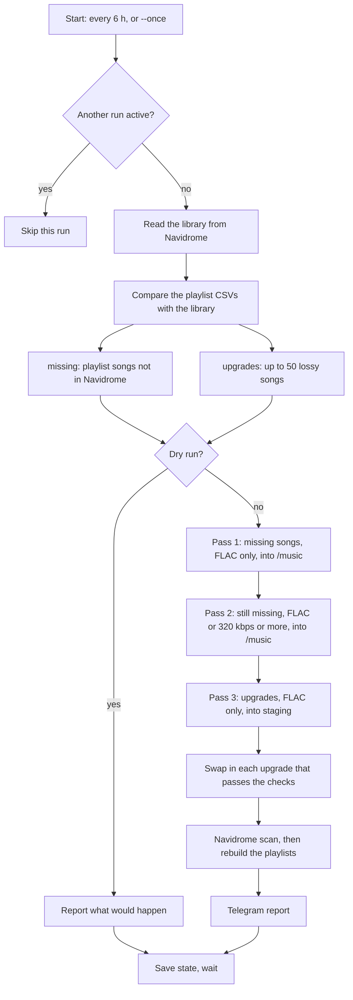

# music-sync and Sockseek

This page explains how the `music-sync` service finds and downloads music, and how to look after it.

- Code: [`arr/music-sync/`](../arr/music-sync/)
- Service: `music-sync` in [`arr/docker-compose.yml`](../arr/docker-compose.yml)
- Versions: `SOCKSEEK_*`, `MUSIC_SYNC_*` and `MUTAGEN_VERSION` in [`version.env`](../version.env)

## Contents

1. [What each part does](#what-each-part-does)
2. [How Sockseek finds a song](#how-sockseek-finds-a-song)
3. [How Sockseek skips songs](#how-sockseek-skips-songs)
4. [One music-sync run](#one-music-sync-run)
5. [How an upgrade keeps Navidrome history](#how-an-upgrade-keeps-navidrome-history)
6. [Files and folders](#files-and-folders)
7. [Settings](#settings)
8. [Common tasks](#common-tasks)
9. [Troubleshooting](#troubleshooting)

## What each part does

| Part | What it is | Its job here |
|---|---|---|
| **Soulseek** | A peer-to-peer network. Users share folders of music, and other users search and download from them. There is no central store of files. | The source of the music. |
| **Sockseek** | A command-line Soulseek client ([fiso64/sockseek](https://github.com/fiso64/sockseek), formerly `slsk-batchdl`). It reads a list of songs, searches for each one, picks the best file and downloads it. | Does every search and download. |
| **music-sync** | A Python job (`music_sync.py`) that runs Sockseek on a schedule. | Decides what to download, runs Sockseek, swaps in upgrades, tells Navidrome to scan, rebuilds playlists and reports to Telegram. |
| **Navidrome** | The music server. | The record of what is already in the library. music-sync reads it through the Subsonic API. |
| **gluetun** | The VPN container. | music-sync runs in gluetun's network namespace, so all Soulseek traffic goes through the VPN. |

Soulseek works by sharing. The music-sync configuration downloads only and shares nothing. Downloading music you have not paid for is copyright infringement in most countries, including India.

## How Sockseek finds a song

music-sync gives Sockseek a CSV file with one song per row: `Artist`, `Title`, `Album`, and for upgrades also `Length` in seconds.

For each row, Sockseek does these steps:

1. **Search.** It sends the search `artist title` to the Soulseek network, in lower case with punctuation removed. The album is not part of the search text; it is used for ranking later. Every online user with a matching file answers. A search waits 5 seconds for answers (`--search-timeout`, default 5000 ms).
   - The Soulseek server blocks searches for some artist names, among them Michael Jackson and Lady Gaga. Sockseek changes the first letter of a blocked word to `*` (for example `*ichael jackson`) so the search still returns results.
2. **Filter.** It removes every result that fails a **required condition**. A result that fails is never downloaded.
3. **Rank.** It sorts the remaining results by the **preferred conditions**. A preferred condition never removes a result; it only moves results up or down.
4. **Download.** It downloads the top result. If the download fails or stalls for 30 seconds (`--max-stale-time`), it tries the next result. A user whose download failed is ranked lower for the rest of the run, and after 2 failures their files are ignored.
5. **Record.** It writes the outcome to the index file: found and downloaded, not found, or failed.

### Required and preferred conditions

| Kind | Option | Effect | music-sync uses |
|---|---|---|---|
| Required | `--format` | Only these file types are accepted. | `flac` in the lossless passes; `flac,mp3,m4a,ogg,opus` in the lossy pass |
| Required | `--cond "br>=320"` | Bitrate must be at least 320 kbps. FLAC always passes. | Lossy pass only |
| Required | `--length-tol` | Length must be within this many seconds of the CSV `Length`. Default 3. | Upgrade pass (the CSV has the old file's length) |
| Preferred | `--pref-format` | Ranks these types higher. The list has no order: `flac,mp3` prefers both equally. | `flac` in every pass |
| Preferred | `--pref-min-bitrate` | Ranks files below this bitrate lower. Default 200. | 320 in the lossy pass |
| Preferred | `--pref-max-samplerate` | Ranks files above this sample rate lower. Default 48000. | Default, so a 44.1 or 48 kHz FLAC ranks above a 96 kHz one |
| Preferred | `pref-strict-title`, `pref-strict-album` | Ranks files whose name contains the title, and whose folder contains the album, higher. On by default. | Default. This is why the `Album` column (the movie name for film songs) matters. |

One limit: many Soulseek clients do not report bitrate. A lossy file with an unknown bitrate passes `br>=320`. `--strict-conditions` would reject it, but it also rejects all files shared from the standard Soulseek client, so music-sync does not use it.

### Speed limits

Soulseek bans clients that search too fast. Sockseek allows 34 searches every 220 seconds (`--searches-per-time`, `--searches-renew-time`), and 2 searches at the same time. So 250 songs need at least 30 minutes of searching, whatever the network speed. A run of about one hour is normal.

music-sync also limits Sockseek to 5 songs at the same time (`--concurrent-jobs 5`; Sockseek's default is 20). With 20, Sockseek used too much memory and too many network connections on this server; see [Troubleshooting](#troubleshooting).

### Where a file is saved

music-sync sets this file-name pattern:

```
{albumartist(/)album(/)title|(missing-tags/)slsk-foldername(/)slsk-filename}
```

- **The file has album artist, album and title tags:** `Album Artist/Album/Title.flac`. This is the same layout Soulbeet uses.
- **Any of those tags is missing:** `missing-tags/<the uploader's folder name>/<the uploader's file name>`.

### Exit codes

| Code | Meaning | music-sync reports it |
|---|---|---|
| 0 | Every song was found. | No |
| 1 | At least one song was not found. This is normal for a list of hard-to-find songs. | No |
| 2 | Sockseek rejected an option or the input file. | Yes, as a warning |
| 130 | Cancelled, for example by `docker stop`. | No |
| Other | Sockseek crashed. | Yes, as a warning |

## How Sockseek skips songs

Sockseek can skip a song for three reasons:

1. **The index says it is already done.** Each pass has its own index file. A row marked as downloaded is not searched again. This is how a stopped run continues where it left off.
2. **The song is already in the music folder** (`--skip-music-dir /music`). Sockseek counts a song as present when a file name contains the title and its folder path contains the artist. This check is strict, so different spellings ("Kadhal" against "Kaadhal") are missed. music-sync does not rely on it: it asks Navidrome first and gives Sockseek only the songs Navidrome does not have. The Sockseek check is a second guard.
3. **`--skip-not-found`**: skips songs that were not found last time. music-sync does **not** use it. Soulseek users come and go, so a song not found today can appear next week.

The upgrade pass does not use `--skip-music-dir`, because the song is in the library on purpose.

## One music-sync run



### Step by step

1. **Lock.** One run at a time, including a manual `--once` run. Two Sockseek processes on one Soulseek account disconnect each other.
2. **Read the library.** music-sync asks Navidrome for every song: title, artist, album, format, bitrate, length, play count and file path. The path is the real one only when **Report Real Path** is on for the `music-sync` player in Navidrome (Settings > Players).
3. **Missing songs.** For each row in `/config/playlists/*.csv`, music-sync searches Navidrome with the same matching as the playlist builder: title first, then artist and album to choose between candidates. Rows with no confident match are missing. A song in several playlists counts once.
4. **Upgrade candidates.** These are lossy songs (MP3, AAC, Ogg, Opus) with a known length and a real path, that were not tried in the last 7 days. Songs in playlists come first, then the most played. A run takes up to 50.
5. **Dry run.** If `SYNC_DRY_RUN` is true, music-sync sends the lists to Telegram and stops here.
6. **Free space.** No downloads when the music disk has less than 10 GB free.
7. **Pass 1, missing songs in FLAC.** Index `index-missing-flac.csv`.
8. **Pass 2, still-missing songs in FLAC or ≥ 320 kbps.** Index `index-missing-any.csv`. FLAC still ranks first.
9. **Pass 3, upgrades in FLAC,** into `/music/.music-sync-staging`. Index `index-upgrades.csv`.
10. **Swap in upgrades.** See the next section.
11. **Scan and playlists.** If anything changed, music-sync starts a Navidrome scan and waits up to 30 minutes for it to finish. Then it rebuilds each playlist in CSV order.
12. **Report.** See [Telegram reports](#telegram-reports).

Each Sockseek pass is stopped after 150 minutes, so a run always ends before the next one is due.

### Telegram reports

- **A run that downloads, upgrades or has a warning:** a report with counts and up to 10 song names per group.
- **A run with nothing new:** no message.
- **A failed run:** always a message, with the step that failed.
- **Once a day, after 09:00:** a quiet summary of the last 24 hours.

## How an upgrade keeps Navidrome history

Navidrome stores plays, ratings, stars and playlist entries per track. When a file disappears and a new one appears, Navidrome's scanner reconnects the history only if it decides they are the same track. In Navidrome 0.64 (`scanner/phase_2_missing_tracks.go`) the scanner:

1. groups files by **persistent ID**, which by default is built from the tags: album (album artist, album name, release date), disc number, track number and title;
2. inside a group, matches by equal tags, by a single candidate, or by **the same path without the extension**.

A FLAC from Soulseek usually has slightly different tags, so its ID would differ and the history would be lost. music-sync avoids that. For each downloaded upgrade it:

1. **Checks the FLAC.** It must be a FLAC file, readable, and within 3 seconds of the old file's length.
2. **Checks the target.** `<old path>.flac` must not exist yet.
3. **Copies the tags.** Every text tag and the front cover from the old file go onto the FLAC. The old file is not changed.
4. **Moves the FLAC** to the old path with the extension `.flac`.
5. **Moves the old file** to `/data/music-retired/`, keeping its folders. Nothing is deleted.

The next scan sees a file with the same ID and the same path stem, and moves the history to it.

A FLAC that fails a check stays in the staging folder and is listed in the report under "Upgrade downloaded but not used". The song is tried again after 7 days.

What this does not catch: a "fake FLAC", an MP3 re-saved as FLAC. It has FLAC's file size but MP3's sound. Detecting it needs audio analysis.

## Files and folders

| On the host | In the container | What it is |
|---|---|---|
| `/configs/music-sync/playlists/*.csv` | `/config/playlists/` | The playlists to keep in step. One CSV per playlist; the file name is the Navidrome playlist name. Not in the repo, because the repo is public. |
| `/configs/music-sync/index-*.csv` | `/config/` | Sockseek's index for each pass. Columns: `filepath, artist, album, title, length, tracktype, state, failurereason`. `state` 1 = downloaded, 2 = failed, 3 = already existed. |
| `/configs/music-sync/state.json` | `/config/` | When each upgrade was last tried, and counts for the daily summary. |
| `/configs/music-sync/sockseek.log` | `/config/` | Sockseek's detailed log: every search, result and failure. |
| `/configs/music-sync/run/` | `/config/run/` | The CSVs given to Sockseek in the last run. |
| `/data/media/music/` | `/music/` | The library. New songs go in as `Album Artist/Album/Title`. |
| `/data/media/music/.music-sync-staging/` | `/music/.music-sync-staging/` | Upgrades waiting to be checked, and those that failed a check. The leading dot hides it from Navidrome and beets. |
| `/data/music-retired/` | `/retired/` | Old files replaced by upgrades. **Not backed up.** Empty it by hand once you have checked the upgrades. |

Backrest backs up everything under `/configs/music-sync`.

## Settings

Set in `arr/.env` (names in `arr/.env.sample`):

| Variable | Default | Meaning |
|---|---|---|
| `MUSIC_SYNC_NAVIDROME_USER` / `_PASSWORD` | none | Navidrome login. Must be an admin to start scans. Owns the rebuilt playlists. |
| `MUSIC_SYNC_SLSK_USERNAME` / `_PASSWORD` | none | Soulseek account. Must not be the one slskd uses. |
| `MUSIC_SYNC_TELEGRAM_BOT_TOKEN` / `_CHAT_ID` | empty | Where reports go. Empty means reports go only to the container log. |
| `MUSIC_SYNC_DRY_RUN` | `true` | `true`: report only. `false`: download and upgrade. |
| `MUSIC_SYNC_UPGRADE_BATCH` | `50` | Upgrades tried per run. |
| `NAVIDROME_IPV4_ADDR` | `172.18.0.40` | Navidrome's fixed address. Docker's DNS names do not work inside gluetun's namespace. |

Set in `arr/docker-compose.yml` or the job's defaults (`music_sync.py`, class `Settings`):

| Variable | Default | Meaning |
|---|---|---|
| `SYNC_INTERVAL_HOURS` | `6` | Time between runs. |
| `LOSSY_MIN_BITRATE` | `320` | Lowest bitrate the lossy pass accepts. |
| `UPGRADE_RETRY_DAYS` | `7` | Wait before trying an upgrade again. |
| `LENGTH_TOLERANCE` | `3` | Seconds an upgrade may differ from the old file. |
| `SOCKSEEK_TIMEOUT_MINUTES` | `150` | Time limit for each Sockseek pass. |
| `SOCKSEEK_CONCURRENT_JOBS` | `5` | Songs Sockseek works on at the same time. |
| `MIN_FREE_GB` | `10` | No downloads below this free space. |
| `DAILY_SUMMARY_HOUR` | `9` | Hour after which the daily summary is sent. |

After a change to `arr/.env` or the compose file, recreate the container:

```bash
export COMPOSE_ENV_FILES=.env,version.env
docker compose up -d music-sync
```

## Common tasks

**Run now, without waiting for the schedule:**

```bash
docker exec music-sync python3 /app/music_sync.py --once
```

If a scheduled run is active, this one is skipped.

**Follow a run:**

```bash
docker logs -f music-sync
```

**See why songs were not found:**

```bash
grep -iE "not found|no results|failed" /configs/music-sync/sockseek.log | tail -30
```

**Add or change a playlist:** edit or add a CSV in `/configs/music-sync/playlists/`. The columns are `Position, Artist, Artists, Title, Album, Original`; music-sync uses `Artist`, `Artists`, `Title` and `Album`. The next run picks it up. Removing a CSV does not delete the playlist in Navidrome.

**Search for a song again that the index marks as downloaded** (for example after you deleted a wrong file): remove its row from the pass's index file in `/configs/music-sync/`.

**Check an upgrade:** the old file is in `/data/music-retired/` at the same relative path. Compare the two, then delete the old one.

**Look at a FLAC that failed a check:** it is in `/data/media/music/.music-sync-staging/`. To use it anyway, copy the tags and move it in by hand, or delete it.

**Update Sockseek:** read the release notes, then set `SOCKSEEK_VERSION` to the new tag and `SOCKSEEK_COMMIT` to the commit it points at:

```bash
git ls-remote https://github.com/fiso64/sockseek refs/tags/<tag>
```

The build fails if the tag and commit do not match. Check that the options music-sync uses (in `run_sockseek` and the three passes) still exist in the new version's README.

## Troubleshooting

| What you see | Cause | Fix |
|---|---|---|
| Report: "Navidrome is not reporting real file paths, so upgrades are off" | Report Real Path is off for the `music-sync` player. The player appears in Navidrome after the first run. | Navidrome: Settings > Players > music-sync > Report Real Path. |
| Report: "Music sync failed while reading the library", with "Wrong username or password" | Wrong `MUSIC_SYNC_NAVIDROME_*` values. | Fix `arr/.env`, recreate the container. |
| Report: failed with a connection error | gluetun is down, or `FIREWALL_OUTBOUND_SUBNETS` is missing, or Navidrome's fixed IP changed. | `docker ps` for gluetun and navidrome; check the gluetun environment in the compose file. |
| Report: "only N GB free on the music disk" | Less than `MIN_FREE_GB` free. | Free space, for example by emptying `/data/music-retired/`. |
| Report: "stopped at the 150-minute limit" | A pass ran too long, usually on the first runs with a long list. | Nothing. The index keeps the progress, and the next run continues. |
| Report: "Sockseek rejected its options or input" | A Sockseek option changed, or a playlist CSV is broken. | Read the end of `/configs/music-sync/sockseek.log`. |
| Sockseek log: "Out of memory" | Too many songs at once. Found in manual runs before music-sync existed. | The compose file sets a 1.5 GB limit and 5 jobs. If it happens again, set `SOCKSEEK_CONCURRENT_JOBS=2`. |
| Sockseek log: "No file descriptors available" | Too many open network connections for Docker's default limit of 1024. | The compose file raises it to 65,536 (`ulimits`). |
| Login errors in the Sockseek log, or downloads stop | Another client is using the same Soulseek account. | Do not run Sockseek by hand with the music-sync account. slskd must use a different account. |
| The same song appears twice in Navidrome | A download that Navidrome did not match to an existing copy. | Use the duplicate finder from the library tidy-up (`music_dedupe.py`), or remove the extra copy by hand. |
